<picture>
  <source media="(prefers-color-scheme: dark)" srcset="assets/banner-dark.svg">
  <source media="(prefers-color-scheme: light)" srcset="assets/banner-light.svg">
  
</picture>

  
  
  

## About me

I'm a Computer Science student at the University of Fort Hare working towards a **SOC Analyst** role. I learn security by building the tools an analyst uses: detection rules, log parsers and triage reports, each tested against realistic attack data and documented with its blind spots.

- **Focus:** detection engineering, log analysis, incident triage and Windows / Active Directory attacks
- **How I work:** every detection is mapped to MITRE ATT&CK, has tests for what it should *and should not* catch, and runs in CI
- **Now learning:** Elastic Stack, Kerberos attack paths, and writing detections as Sigma rules

## Featured security projects

<table>
<tr>
<td width="50%" valign="top">

### [soc-log-triage](https://github.com/1ungaka/soc-log-triage)
Turns Linux `auth.log` / auditd, Windows Security, Sysmon, domain controller and web server logs into **ATT&CK-mapped alerts**. Detects brute force, password spraying, Kerberoasting, AS-REP roasting, encoded PowerShell, Office macros spawning shells, backdoor admins, log clearing, web path traversal and scanning.

`16 detections` `131 tests` `Sigma rules validated in CI`

  

</td>
<td width="50%" valign="top">

### [phishing-analyser](https://github.com/1ungaka/phishing-analyser)
Analyses suspicious `.eml` files and explains every point of its 0 to 100 risk score: SPF / DKIM / DMARC verdicts, lookalike and homoglyph domains (including South African banks and SARS), deceptive links, risky attachments and social engineering language.

`web app + CLI` `explainable scoring`

 

</td>
</tr>
<tr>
<td width="50%" valign="top">

### [statistical-baseline-alerting](https://github.com/1ungaka/statistical-baseline-alerting)
Finds anomalous login behaviour with **statistics instead of signatures**: z-scores and IQR fences on hourly event volume, failures and unique source IPs, combined into a severity-ranked alert queue in an interactive dashboard.

`anomaly detection` `no threat feeds needed`

 

</td>
<td width="50%" valign="top">

### [AfriSafety](https://github.com/1ungaka/AfriSafety)
A privacy-first safety and location-sharing app for South Africa. Locations are **end-to-end encrypted** with libsodium, so the server cannot see where anyone is, and access is enforced with Postgres row-level security.

`privacy by design` `E2E encryption`

 

</td>
</tr>
</table>

## Detection coverage

What my detections in [soc-log-triage](https://github.com/1ungaka/soc-log-triage) cover, by ATT&CK tactic (ATT&CK v20.1):

| Tactic | Techniques I detect |
|---|---|
| Reconnaissance | T1595.002 Vulnerability Scanning · T1595.003 Wordlist Scanning |
| Initial Access | T1566.001 Spearphishing Attachment · T1190 Exploit Public-Facing Application |
| Execution | T1059.001 PowerShell · T1204.002 Malicious File |
| Persistence | T1136.001 Create Local Account · T1098 Account Manipulation |
| Privilege Escalation | T1098 Account Manipulation (privileged groups) |
| Stealth | T1027 Obfuscated Files or Information |
| Defense Impairment | T1685.005 Clear Windows Event Logs |
| Credential Access | T1110.001 Password Guessing · T1110.003 Password Spraying · T1558.003 Kerberoasting · T1558.004 AS-REP Roasting |
| Command and Control | T1105 Ingress Tool Transfer · T1071.001 Web Protocols |

## Toolkit

**Security** &nbsp;     

**Languages** &nbsp;      

**Data & tooling** &nbsp;     

## Certifications in progress

 

Studying for CompTIA Security+ and Microsoft Azure Fundamentals (AZ-900).

## Beyond security

I also enjoy reproducible data work: a [probabilistic forecast of hung councils](https://github.com/1ungaka/za-metro-councils-2026) in five South African metros for the 2026 local elections, and a [pre-registered audit](https://github.com/1ungaka/ec-lge2026-scenario-audit) of how well election scenarios predicted Eastern Cape results.

 

<picture>
  <source media="(prefers-color-scheme: dark)" srcset="https://raw.githubusercontent.com/1ungaka/1ungaka/output/github-snake-dark.svg">
  <source media="(prefers-color-scheme: light)" srcset="https://raw.githubusercontent.com/1ungaka/1ungaka/output/github-snake.svg">
  
</picture>
